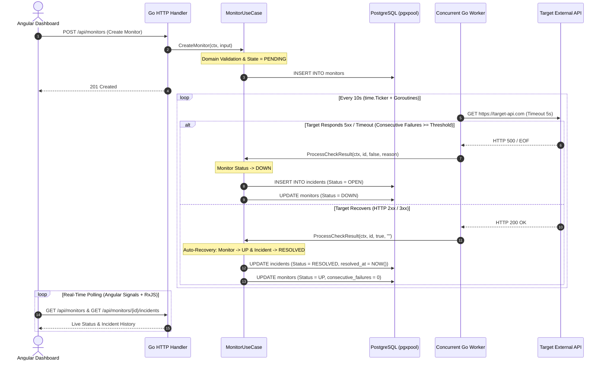

# ⚡ PulseWatch — Distributed Health Check & Incident Management Platform

[](https://github.com/FelipeCJSEP/pulsewatch/actions/workflows/ci.yml)


A production-ready fullstack observability, health-checking, and automated incident management platform built to demonstrate **Senior-Level Clean Architecture in Go**, **Domain-Driven Design (DDD)**, **Concurrent Background Workers with Goroutines**, **High-Performance Explicit SQL (`pgx`)**, **Modern Angular (Standalone Components & Signals)**, and **GitHub Actions CI/CD**.

---

## 🏛️ Architecture & System Design

The system implements the **Dependency Inversion Principle** and **Clean Architecture (Ports & Adapters)** idiomatically in Go, leveraging `internal/` package boundaries to strictly decouple core business rules from persistence, HTTP delivery, and background workers.

```text
                              ┌─────────────────────────────────────────┐
                              │       Angular SPA (pulsewatch-web)      │
                              │   (Signals + Reactive Forms + RxJS)     │
                              └────────────────────┬────────────────────┘
                                                   │ HTTP / REST (JSON)
                                                   ▼
┌──────────────────────────────────────────────────────────────────────────────────────────────────┐
│  Delivery Layer (internal/delivery/http)                                                         │
│  ├── MonitorHandler (REST Endpoints via Go 1.22+ ServeMux)                                       │
│  └── CORS Middleware & Request/Response DTOs                                                     │
├──────────────────────────────────────────────────────────────────────────────────────────────────┤
│  Application Layer (internal/application)                                                        │
│  ├── MonitorUseCase (Orchestration of Monitor Registration, Health Checks & Incidents)           │
│  ├── Auto-Incident Opening (Triggered on consecutive failure thresholds)                         │
│  └── Auto-Healing / Auto-Recovery (Resolves open incidents automatically when target recovers)   │
├──────────────────────────────────────────────────────────────────────────────────────────────────┤
│  Domain Layer (internal/domain - 100% Pure Go)                                                   │
│  ├── Entities & State Machines (Monitor, Incident)                                               │
│  ├── Sentinel Domain Errors (Errors as Values: ErrMonitorNameRequired, ErrNotFound, etc.)        │
│  └── Implicit Repository Contracts (MonitorRepository, IncidentRepository)                       │
├──────────────────────────────────────────────────────────────────────────────────────────────────┤
│  Infrastructure Layer (internal/infrastructure)                                                  │
│  ├── PostgreSQL 16 Repositories via pgxpool (Explicit SQL, Zero ORM Reflection Overhead)         │
│  └── Concurrent HTTP Worker (Goroutines + time.Ticker + Graceful Shutdown via context.Context)   │
└──────────────────────────────────────────────────────────────────────────────────────────────────┘
```

### Folder Structure

```text
PulseWatch/
├── cmd/
│   └── api/
│       └── main.go                      # Composition Root (Explicit DI, HTTP Server & Worker bootstrap)
├── internal/
│   ├── domain/                          # Pure Go Entities, State Machines, Sentinel Errors & Unit Tests
│   ├── application/                     # Use Cases, Auto-Recovery Orchestration & In-Memory Fake Tests
│   ├── infrastructure/
│   │   ├── postgres/                    # High-performance PostgreSQL adapters using pgx/v5
│   │   └── checker/                     # Concurrent background HTTP health-check worker (Goroutines)
│   └── delivery/
│       └── http/                        # REST API Handlers & JSON serialization
├── migrations/
│   └── 001_init.sql                     # Automatic PostgreSQL schema initialization
├── pulsewatch-web/                      # Modern Angular Frontend SPA (Signals, Reactive Forms, RxJS)
├── .github/workflows/
│   └── ci.yml                           # Automated CI Pipeline (go vet, go test, Angular production build)
├── Dockerfile                           # Multi-Stage Docker build (~15MB static Alpine image)
└── docker-compose.yml                   # Local PostgreSQL 16 container orchestration
```

---

## ⚡ Concurrent Health Check & Auto-Recovery Lifecycle



---

## 🌟 Key Senior Architectural Highlights

### 1. Idiomatic Go Clean Architecture & Implicit Interfaces
- Leverages Go's **`internal/`** compiler boundary to enforce strict architectural encapsulation.
- Uses **Implicit Interfaces** (Duck Typing at compile time) defined in the `domain` package (`MonitorRepository`, `IncidentRepository`), keeping the core domain 100% free of infrastructure or database driver imports.
- **Explicit Dependency Injection** wired in `cmd/api/main.go` (`Composition Root`) without magic reflection containers.

### 2. Rich Domain Model & "Errors as Values"
- Entities (`Monitor` and `Incident`) protect their own invariants and state transitions (`PENDING` ➔ `UP` / `DOWN` / `PAUSED` and `OPEN` ➔ `ACKNOWLEDGED` ➔ `RESOLVED`) through pointer-receiver methods (`RecordSuccess()`, `RecordFailed()`, `Acknowledge()`, `Resolve()`).
- Strictly follows Go's **"Errors as Values"** philosophy using domain-level sentinel errors (`ErrMonitorNameRequired`, `ErrIncidentAlreadyResolved`, `ErrNotFound`) and translating driver-specific errors (`pgx.ErrNoRows`) at the infrastructure boundary via `errors.Is`.

### 3. Concurrent Background Worker with Goroutines & `context.Context`
- Instead of sequential blocking checks, the background `Worker` uses `time.NewTicker` and spawns lightweight **Goroutines (`go w.checkOne(ctx, m)`)** to probe all active endpoints concurrently.
- Supports **Graceful Shutdown** via `select` listening on `<-ctx.Done()` and enforces strict per-request HTTP timeouts (`5s`) and database query cancellation propagation via `context.Context`.

### 4. High-Performance Persistence with Explicit SQL (`pgx/v5`)
- Avoids heavy ORM reflection overhead in favor of explicit, parameterized SQL queries executed over a concurrent connection pool (`pgxpool.Pool`).
- Uses variadic query helpers (`args ...any`), explicit column projection, and safe resource cleanup with `defer rows.Close()`.

### 5. Fast Unit Testing with In-Memory Fakes
- Domain and Application layers are tested using Go's native `testing` package (`_test.go`), verifying state machine thresholds, failure counters, and automatic incident creation/resolution in `< 10ms` using lightweight in-memory map fakes (`map[string]*domain.Monitor`) without external mocking frameworks.

### 6. Modern Reactive Frontend (Angular)
- Built with modern **Angular Standalone Components** (zero legacy `NgModules`).
- **Angular Signals (`signal`)** for fine-grained reactive state management alongside **RxJS `Observable`** streams and `HttpClient`.
- **Typed Reactive Forms (`FormBuilder`)** with synchronous validators and modern template control flow (`@if`, `@for`, `@empty`).

---

## 🛠️ Tech Stack

| Category | Technology |
| :--- | :--- |
| **Backend Language** | Go (Golang 1.22+) |
| **Architectural Patterns** | Clean Architecture, DDD, Ports & Adapters, Explicit DI |
| **HTTP Routing** | Go 1.22+ Enhanced `net/http` `ServeMux` + Custom CORS Middleware |
| **Concurrency** | Goroutines, Channels (`select`), `time.Ticker`, `context.Context` |
| **Database & Driver** | PostgreSQL 16 + `jackc/pgx/v5` (`pgxpool`) |
| **Observability** | Structured Logging with Go standard `log/slog` |
| **Testing** | Go native `testing` package + In-Memory Fakes |
| **Frontend Framework** | Angular (Standalone Components, Signals, Reactive Forms, RxJS) |
| **DevOps & CI/CD** | Docker Multi-Stage Build (Alpine Linux), Docker Compose, GitHub Actions |

---

## 🚀 Getting Started

### Prerequisites
- [Go SDK](https://go.dev/dl/) (1.22+)
- [Node.js](https://nodejs.org/) (v20+ LTS)
- [Docker Desktop](https://www.docker.com/products/docker-desktop/)

---

### 1. Clone & Start Infrastructure (PostgreSQL 16)

```bash
git clone https://github.com/FelipeCJSEP/pulsewatch.git
cd pulsewatch

# Starts PostgreSQL 16 and automatically runs ./migrations/001_init.sql
docker compose up -d
```
> - **PostgreSQL:** `localhost:5432` (User: `pulsewatch` | Pass: `pulsewatch123` | DB: `pulsewatch_db`)

---

### 2. Run Backend (API + Concurrent Worker)

```bash
go run ./cmd/api
```
> - **REST API Base URL:** `http://localhost:8080/api`
> - **Health Check Worker:** Automatically runs in the background every 10 seconds.

---

### 3. Run Frontend (Angular Dashboard)

```bash
cd pulsewatch-web
npm install
npm start
```
> - **Web Dashboard:** Open [http://localhost:4200](http://localhost:4200)

---

## 🧪 Running Automated Tests & Static Analysis

```bash
# Run Go static analyzer
go vet ./...

# Run all Domain and Application unit tests
go test ./... -v
```

---

## 📄 License
This project is licensed under the MIT License.